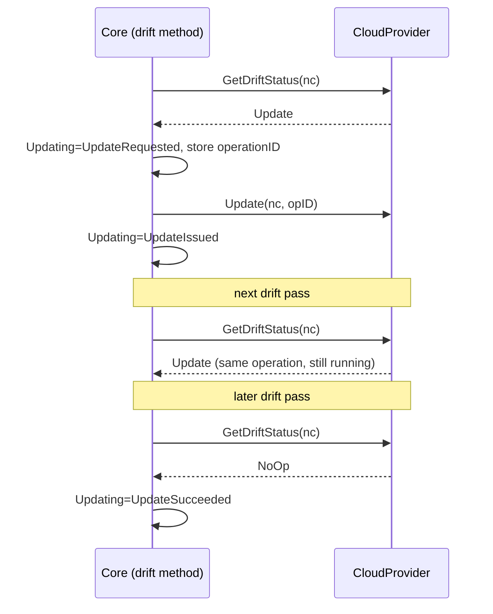

# In-Place Drainless Drift Remediation

Let a cloud provider change settings on a running node without draining or rebooting it, both to resolve NodeClass drift and to apply a one-off override to a single node.

This builds on [In-Place Drift Remediation](https://github.com/kubernetes-sigs/karpenter/pull/3460) (#3460). That RFC replaces `IsDrifted` with `GetDriftStatus` (`NoOp | Replace | Reboot`) and resolves drift in place through the reboot lifecycle. This RFC adds a fourth action, `Update`, for changes that need no drain and no reboot. It also adds a per-NodeClaim override, so an operator can change one node in an emergency without changing its NodeClass. Which settings qualify, and how they're applied, is up to each provider and is covered in provider RFCs.

## Motivation

#3460 gives drift a second remedy, a reboot that keeps the instance. Some changes don't need even that. The provider can apply them to the running instance while pods keep running, for example block storage performance or cloud resource tags (#1123). For these, both of today's remedies cost more than they need to. `Replace` evicts every pod onto a new node. `Reboot` keeps the instance but drains it, which #3460 notes means longer pod downtime than replacement. Either way the fix lands only after a rollout paced by disruption budgets, PDBs and `terminationGracePeriod`.

A second gap is that the NodeClass is the only lever, and it applies to every node. When one node is in trouble, an operator has to pick between two bad options:

- Change the NodeClass, which changes and pays for every node in it, to fix one.
- Create a new NodePool and NodeClass for the workload, then wait for it to schedule elsewhere.

Neither is quick enough during an incident. If the provider can apply the change to the running node, the operator should be able to target that one node directly.

A concrete case is block storage throughput. A data workload on one node is throttled at its volume's throughput limit. The provider can raise throughput on the attached volume in seconds. Today the only ways to get there are to raise it for the whole NodeClass and roll every node, or to call the cloud API by hand outside Karpenter, which is impossible on managed offerings (for example EKS Auto Mode) where node resources can't be changed by the user.

### Use Cases

- **Emergency scale-up of one node.** On-call sees one node's workload throttled by storage or network limits. They annotate that node's NodeClaim with higher values. The node gets them within minutes, nothing is evicted, and no other node changes.
- **Fleet-wide change without a rollout.** A platform team raises a provisioned setting on a NodeClass. Every running node gets it in place, without being drained.
- **Back to baseline.** After the incident or a load test, the override is removed, or the NodeClass is lowered, and nodes go back to the cheaper settings in place.

### Non-Goals

- **Which settings can be updated without draining, and how.** Provider-specific, in provider RFCs.
- **Changes that need a reboot or a new instance.** Those are #3460's `Reboot` and today's `Replace`.
- **Changes to node capacity**, such as volume size, hugepages, CPU or memory. The kubelet has to agree on new capacity, which depends on [KEP-3953](https://github.com/kubernetes/enhancements/issues/3953).
- **In-place NodePool template labels.** Labels affect scheduling, as [drift.md](./drift.md#-in-place-drift) notes.
- **Standing per-workload policy.** Overrides are one-off and node-scoped. Policy belongs in the NodePool and NodeClass.
- **Keeping overrides across replacement.** A replacement node starts from its NodeClass.

## Proposal

### Proposed Spec

No new CRDs or CRD fields.

**A fourth `DisruptionAction`**, ordered between `NoOp` and `Reboot`, so #3460's `IsMoreDisruptiveThan` keeps working:

| Action | Meaning | Pods evicted | Instance kept |
|---|---|---|---|
| `NoOp` | Not drifted | No | Yes |
| `Update` | **New.** The provider applies the change to the running instance without draining or rebooting | No | Yes |
| `Reboot` | Resolved through the reboot lifecycle (#3460) | Yes | Yes |
| `Replace` | Replace the node | Yes | No |

**A new `CloudProvider` method**, shaped like `Reboot`:

```go
// Update applies settings to the running instance without draining or rebooting it.
// operationID identifies one logical update; providers should use it to make retries replay-safe.
// Update returns once the provider accepts the request. Completion is confirmed on the next drift
// pass through GetDriftStatus.
//
// Providers that never return the Update action return *NodeUpdateNotImplementedError.
// An update that retrying can't make succeed returns *NodeUpdateFailedError.
// A provider-side rate limit returns *NodeUpdateThrottledError with a RetryAfter.
Update(ctx context.Context, nodeClaim *v1.NodeClaim, operationID string) error
```

**A NodeClaim override annotation.** Core owns the key, and the provider owns the value:

```yaml
apiVersion: karpenter.sh/v1
kind: NodeClaim
metadata:
  name: general-purpose-abcde
  annotations:
    karpenter.sh/nodeclass-override: '<provider-defined JSON>'
```

**A NodeClaim condition**, alongside `Rebooting`:

```yaml
status:
  conditions:
    - type: Updating
      status: "True"
      reason: UpdateIssued    # UpdateRequested | UpdateIssued | UpdateThrottled | UpdateSucceeded | UpdateFailed | OverrideRejected
      message: "<provider progress message>"
```

### How It Works

#### Updates driven by drift



1. **The provider decides, as in #3460.** `GetDriftStatus` returns `Update` only when every difference can be applied without draining or rebooting, and the NodeClass has opted in. Otherwise it returns the most disruptive action needed, and whatever is left is handled on later drift passes. For example, a node that needs a `Reboot` for one reason and an `Update` for another is rebooted first, then updated on the next pass if the setting still differs.
2. **No commit, no fence, no drain.** `Update` skips scheduling simulation, replacement, cordoning and eviction. Core sets `UpdateRequested` with a new `operationID` stored in `karpenter.sh/update-operation-id` and calls `Update`. The `operationID` stays the same until the condition leaves `UpdateIssued`, so restarts and retries join the same operation.
3. **Confirm on the next drift pass, as in #3460.** The provider answers from its own record of the operation. It returns `Update` while the operation is running, `NoOp` once it has landed, and `Replace` if it failed. `Replace` takes today's drift path, so a replacement is launched before the node is drained.
4. **Throttling.** `NodeUpdateThrottledError` sets `UpdateThrottled` and requeues after `RetryAfter`. Core keeps the retry time on the NodeClaim (`karpenter.sh/update-retry-after`) and doesn't call the provider again before it, even across restarts or unrelated reconciles. The condition message must not carry per-call details such as request IDs, and the controller reconciles only on annotation or generation changes. Otherwise its own status writes retrigger it. The prototype missed this at first and called `ModifyVolume` 4,930 times in 28 minutes against a volume EBS had already refused until the next day. A throttled node isn't replaced for that reason. It keeps its current settings until the provider can apply the new ones.
5. **Backstop.** As with `RebootHistory` on the repair path, a NodeClaim that keeps asking for `Update` without converging gets `Replace` instead. Throttled waits don't count.

#### Per-node overrides

The override changes what `GetDriftStatus` compares against for one NodeClaim. Without it, the target is the NodeClass. With it, the target is the NodeClass with the override applied on top. Everything else uses the same flow.

1. An operator sets `karpenter.sh/nodeclass-override` on a NodeClaim.
2. On the next drift pass, the provider validates the value. An override is accepted only if every field in it is one the provider can update without draining. Anything else, including a parse error or a value outside the provider's limits, is rejected. Core sets `Updating=False` with `OverrideRejected` and the provider's message, emits an event, and changes nothing. An override can never cause a reboot or a replacement.
3. If it's valid and differs from the node, `GetDriftStatus` returns `Update`, and the node is updated as above.
4. Removing the annotation sets the target back to the NodeClass, which is another `Update`.
5. Later NodeClass changes still apply to the fields the override doesn't set.

Core doesn't parse the value. It only acts on whether the annotation is present and on what the provider returns. Each provider documents its schema in its own RFC, keyed by stable identifiers (for example a device name, not a list index), so overrides can be partial.

**External recommenders.** Anything with `patch` on NodeClaims can write the override: an operator, or a recommender such as an ERO-run volume right-sizer. Recommenders should:

- merge into the existing value instead of replacing it;
- leave a value they can't parse alone;
- hold while `Updating` is `True`;
- budget for the provider's rate limits. EBS allows 4 modifications per volume per rolling 24h. A right-sizer should keep the last one for growing size.

**Why on the NodeClaim and not the Node.**

- NodeClaim metadata can change even though its spec can't, and the NodeClaim is the Karpenter object for one instance.
- The kubelet owns the Node, and with NodeRestriction it can still change annotations on its own Node. A compromised node could raise its own settings and run up cost. CNIs and other DaemonSets often have `patch nodes` as well. Far fewer principals have `patch nodeclaims`.
- Karpenter doesn't read Node annotations as input today.

Who can make emergency changes is then controlled by RBAC on `nodeclaims` `patch`. A cluster admin on EKS Auto Mode already has it.

### Interaction with Existing Features

- **Disruption budgets.** `Update` doesn't fence or evict, so it doesn't count against the `Drifted` budget. A `Drifted` budget of `0` stops drift-driven updates, because users who freeze drift expect their nodes to stay unchanged. It doesn't stop overrides. An override is an explicit operator action on one node, and it's most needed when the fleet is frozen during an incident.
- **PDBs, `do-not-disrupt` and `terminationGracePeriod`.** Nothing is evicted, so none of them block `Update`. #3460's `terminationGracePeriod` requirement doesn't apply.
- **Consolidation.** Unchanged for drift-driven updates. A NodeClaim with an override is skipped by consolidation. A replacement wouldn't keep the override, and providers price only the instance, so consolidation would otherwise swap the boosted node for one without the boost.
- **Drift that needs `Replace` or `Reboot`, expiry and repair.** These still apply to overridden nodes. A replacement starts from the NodeClass, and an event on the old NodeClaim records that the override was dropped. After a reboot, the provider checks again on the next drift pass and returns `Update` if a setting no longer matches the target.
- **Reboot and repair.** While a node is `Rebooting`, `Update` waits. `Update` isn't a repair action and isn't valid in `RepairPolicies`.
- **Cost.** A NodeClass change applies its cost to every running node at once, instead of over a rollout. An override applies cost to one node for as long as it stays. Events and docs say both.

### Observability

- The `Updating` condition, with the provider's progress message.
- Events when an update is issued, throttled, succeeds or fails. Also when an override is accepted, rejected or dropped by a replacement.
- Metrics `karpenter_nodeclaims_updates_total{nodepool, trigger, result}` (`trigger` is `drift` or `override`) and `karpenter_nodeclaims_update_duration_seconds{nodepool, trigger}`.
- `kubectl get nodeclaims -o custom-columns='NAME:.metadata.name,OVERRIDE:.metadata.annotations.karpenter\.sh/nodeclass-override'` lists overridden nodes. Docs include it.

### Edge Cases

- **Override set and removed within a provider's cooldown.** The removal is `UpdateThrottled` until the cooldown ends. The condition says when it will retry.
- **Override and a NodeClass change on the same field.** The override wins until it's removed.
- **Override on a provider without `Update`.** Rejected with `OverrideRejected`.
- **Override on a node whose drift needs `Replace`.** The node is replaced, and the override is dropped with an event. Operators who need the node to stay can add `karpenter.sh/do-not-disrupt` as they would today.
- **Controller restart mid-update.** `Update` is called again with the same `operationID`.
- **Update fails.** The next `GetDriftStatus` returns `Replace` for drift-driven updates. For an override, the provider returns `NoOp` with the failure recorded, and core sets `UpdateFailed` and keeps the node. A failed emergency change shouldn't take the node away too.

### Guidance for providers

- **Splitting the hash.** Static drift compares one hash of the whole NodeClass spec, and a hash can't say which field changed. A provider that offers `Update` for hashed fields should keep two hashes on the NodeClaim, one for fields that need replacement and one for fields that can be updated without draining. It should bump its hash version so existing NodeClaims are backfilled, not drifted ([drift-hash-versioning.md](./drift-hash-versioning.md)).
- **Opt-in.** As in #3460, each provider opts in per NodeClass, with a field excluded from the drift hash. Overrides need no opt-in, because they're explicit per node.
- **Record what was applied.** The provider should record what it applied on the NodeClaim, so `GetDriftStatus` doesn't rely on eventually consistent cloud reads. This is the same problem as #3460's open question 3, where `Status.ImageID` is stale after an in-place change.

## Prototype Demo

A prototype of this design runs end to end on EKS (Kubernetes 1.35, ca-central-1), with modified Karpenter core (AndrewSirenko/karpenter `inplace-poc`) and provider-aws (AndrewSirenko/karpenter-provider-aws `inplace-poc`). The prototype covers per-node overrides only. Drift-driven `Update` isn't built yet.

Setup: one NodeClaim `inplace-lpcft` (c6a.large, `i-053cf8b312a3c128c`) from an EC2NodeClass whose root volume `/dev/xvda` is gp3, 20 GiB, 3000 IOPS, 125 MiB/s. It runs one pod.

Outputs are trimmed to the relevant columns. The full command log, scripts and mutation run are in [`test/inplace-poc/`](https://github.com/AndrewSirenko/karpenter-provider-aws/tree/inplace-poc/test/inplace-poc) on the provider-aws branch.

**Before**

```console
$ aws ec2 describe-volumes --volume-ids vol-06834de2b44ed41f1 \
    --query 'Volumes[].{Iops:Iops,Throughput:Throughput,Size:Size,Type:VolumeType}' --output table
+------+-------+-------------+-------+
| Iops | Size  | Throughput  | Type  |
+------+-------+-------------+-------+
|  3000|  20   |  125        |  gp3  |
+------+-------+-------------+-------+
```

**Override one node**

```console
$ kubectl annotate nodeclaim inplace-lpcft \
    'karpenter.sh/nodeclass-override={"blockDeviceMappings":{"/dev/xvda":{"iops":6000,"throughput":500}}}'
nodeclaim.karpenter.sh/inplace-lpcft annotated

$ kubectl get nodeclaim inplace-lpcft -o jsonpath='{.status.conditions[?(@.type=="Updating")]}'
{"message":"provider is applying the update","reason":"UpdateIssued","status":"True","type":"Updating"}
```

About 20 seconds later the volume already reports the new values while EBS is still optimizing:

```console
$ aws ec2 describe-volumes-modifications --volume-ids vol-06834de2b44ed41f1 \
    --query 'VolumesModifications[].{State:ModificationState,FromIops:OriginalIops,ToIops:TargetIops,FromThroughput:OriginalThroughput,ToThroughput:TargetThroughput}'
State: optimizing   FromIops: 3000  ToIops: 6000   FromThroughput: 125  ToThroughput: 500
```

**After** (`completed` at 02:44:09Z, about 5 minutes after the annotation)

```console
$ aws ec2 describe-volumes --volume-ids vol-06834de2b44ed41f1 \
    --query 'Volumes[].{Iops:Iops,Throughput:Throughput,Size:Size,Type:VolumeType}' --output table
+------+-------+-------------+-------+
| Iops | Size  | Throughput  | Type  |
+------+-------+-------------+-------+
|  6000|  20   |  500        |  gp3  |
+------+-------+-------------+-------+

$ kubectl get nodeclaim inplace-lpcft -o jsonpath='{.status.conditions[?(@.type=="Updating")]}'
{"message":"instance matches its target","reason":"UpdateSucceeded","status":"False","type":"Updating"}
```

The node was never drained or rebooted:

| Check | Before | After |
|---|---|---|
| Instance ID | i-053cf8b312a3c128c | i-053cf8b312a3c128c |
| Node boot ID | a678f864-8f81-441d-940f-d806bc49b978 | a678f864-8f81-441d-940f-d806bc49b978 |
| Pod UID | 401d48bd-da79-42a6-b9a2-b67739851cfc | 401d48bd-da79-42a6-b9a2-b67739851cfc |
| Pod restarts | 0 | 0 |
| `spec.unschedulable` | unset | unset |
| NodeClaims in the NodePool | 1 | 1 |

**Invalid override is rejected and changes nothing**

```console
$ kubectl annotate nodeclaim inplace-lpcft --overwrite \
    'karpenter.sh/nodeclass-override={"blockDeviceMappings":{"/dev/xvdz":{"iops":9000}}}'
$ kubectl get nodeclaim inplace-lpcft -o jsonpath='{.status.conditions[?(@.type=="Updating")].message}'
in-place update failed, device "/dev/xvdz" is not in EC2NodeClass "inplace" blockDeviceMappings
$ aws ec2 describe-volumes --volume-ids vol-06834de2b44ed41f1 --query 'Volumes[0].[Iops,Throughput]' --output text
6000    500
```

**Remove the override, back to the NodeClass**

```console
$ kubectl annotate nodeclaim inplace-lpcft karpenter.sh/nodeclass-override-
# controller log: "modifying volume" fromIOPS=6000 toIOPS=3000 fromThroughput=500 toThroughput=125
$ aws ec2 describe-volumes --volume-ids vol-06834de2b44ed41f1 --query 'Volumes[0].[Iops,Throughput]' --output text
3000    125
```

The revert went through 16 seconds after the first modification completed, and EBS didn't throttle it. It completed at 02:49:29Z with `UpdateSucceeded`, on the same instance and pod.

**Mutation check.** The same core with a provider built without the EC2 volume wiring rejects the override with `OverrideRejected` ("in-place update is not implemented by the cloud provider"), and the volume stays at 3000/125.

**Tests.** The core `nodeclaim.inplace` Ginkgo suite passes 7/7. Removing the step that records the applied override fails 2 of them.

## Alternatives Considered

### Reboot without a drain

Reuse `Reboot` and let the provider skip the reboot. Rejected because the reboot lifecycle drains first and completes on a new boot ID. A drainless update never reboots.

### Separate detection and status hooks

Rejected for the same reason #3460 rejected `DriftRemediation` and `RebootStatus`. `GetDriftStatus` already picks the action and confirms completion.

### Overrides on the Node

Rejected for the security reasons above.

### Overrides as a new CRD

A `NodeClaimOverride` object would give typed validation and clearer RBAC, but it's much more API than one annotation for an emergency tool. It can be added later if annotations prove too loose.

### A NodePool and NodeClass per workload

Works today without new API, but it's far too slow for an incident and leaves behind NodeClasses created for one emergency.

### Calling the cloud API directly

The self-managed workaround today. Nothing reconciles it, and a later replacement silently drops it. On managed offerings it isn't possible.

## Backward Compatibility

- Depends on #3460's `GetDriftStatus` and `DisruptionAction`. Providers that don't support it add an `Update` method that returns `NodeUpdateNotImplementedError`, and they reject overrides.
- No CRD changes. Nothing changes until a NodeClass opts in or an operator sets an override.
- Providers that split their hash must bump its version.

## Graduation Criteria

- **Alpha.** No core feature gate, as in #3460. Drift-driven updates are gated by the provider's NodeClass opt-in. Overrides are gated by an `InPlaceOverrides` feature gate, off by default, because they're new user-facing behavior on every NodeClaim. Proven with one provider, with E2E tests showing the instance ID doesn't change, no pod is evicted, and the target is reached, for both a NodeClass change and an override.
- **Beta.** Production data on update duration and throttling. A second consumer, such as tags or a second provider.

## Open Questions

1. Should a `Drifted` budget of `0` stop drift-driven updates, as proposed, or should drainless updates ignore budgets entirely?
2. Should overrides expire on their own, through something like `karpenter.sh/nodeclass-override-expire-after`, so a forgotten emergency change doesn't keep costing money?
3. Should overrides be allowed to lower settings below the NodeClass, or only raise them?
4. Should the override value be validated against a schema the provider publishes, so `kubectl` users get errors before the drift pass?
5. Should recording applied settings be standardized in core, as a NodeClaim status field shared with #3460's `ImageID` problem?
6. Should providers expose a resource's remaining change budget, for example EBS's 4 per 24h, on the NodeClaim, so recommenders don't have to track it themselves?

## Future Work

- **Resolved node configuration.** A core record of each NodeClaim's actual settings, shared by in-place updates, overrides and dynamic NodeClass fields (ranges chosen from pod requests). Separate RFC, for the working group.
- **Capacity changes.** Volume growth and hugepages through `Update` once KEP-3953 lets the kubelet pick up new capacity on a running node.
